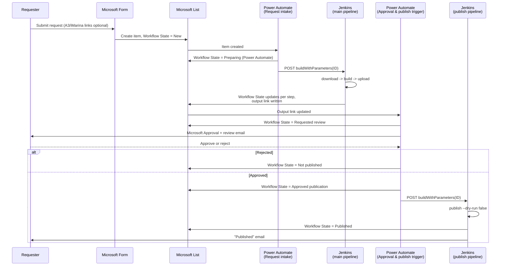

# The end-to-end workflow

The CLI commands (see [Architecture overview](architecture-overview.md)) are
only part of the picture. This page walks through the *whole* journey a load
request takes — from a human filling in a form, to a file landing on the
live iMarina server — including the parts that live outside this repository
entirely: the Microsoft Form, the Microsoft List, and the two Power Automate
flows that glue everything together.

## 1. A human submits the request

Whoever needs a load run (a small, named set of people — see
[Data protection and GDPR](data-protection.md)) fills in a Microsoft Form,
optionally providing links to a fresh A3 dump and/or a specific previous
iMarina upload. Submitting it creates an item in a Microsoft List with a
unique ID and Workflow State `New` — see
[How to request an iMarina load](../how-to/request-an-imarina-load.md) for
the requester's side of this step.

## 2. The first Power Automate workflow starts the pipeline

The new list item triggers a Power Automate flow ("Request intake"). Before
doing anything else, it sets Workflow State to `Preparing (Power Automate)`,
then makes an HTTP call to Jenkins, passing the item's ID as a build
parameter. This is the only step that turns a form submission into an
actual pipeline run — and it's entirely outside this repository (documented,
not code, in `power-automate/README.md`).

## 3. Jenkins runs download → build → upload

The main Jenkins job runs the three CLI commands in sequence, each wrapped
in its own error handler that emails the requester and marks the request
`Error` if that step fails. `download` populates local input files (falling
back to "the latest known file" for anything the requester didn't supply a
link for); `build` produces the next iMarina spreadsheet; `upload` pushes it
to a SharePoint review folder and writes a sharing link back onto the list
item.

## 4. The second Power Automate workflow asks for approval

Writing that output link triggers a second Power Automate flow. Just before
it starts a Microsoft Approval, it sets Workflow State to `Requested
review` — the load file is already built at this point, and this flow is
about to ask the original requester for permission to publish it. The
approval carries a link to the file for review.

## 5. A human approves or rejects

Nothing stops the requester from editing the generated file directly on
SharePoint before deciding — the publish pipeline (step 6) later fetches
whatever is currently at the "iMarina Excel output link" at approval time,
not a snapshot taken when `upload` first wrote it. So a requester who finds
fixable errors can correct them in place and then approve, and those
corrections are what gets published; there's no separate resubmission step.

- **Reject** → Workflow State becomes `Not published`. Nothing further
  happens; the file is never sent to iMarina.
- **Approve** → Workflow State immediately becomes `Approved publication`,
  and the same Power Automate flow makes an HTTP call to a *second*,
  separate Jenkins job.

## 6. The publish pipeline runs

That second Jenkins job runs `publish --dry-run false`, which pushes the
file over FTP to the live iMarina server, archives a copy to SharePoint
(unconditionally, so the next run's fallback logic can find it later), and
marks the request `Published`. `notify --status published` then emails the
requester confirming it actually went through — deliberately different
wording from the earlier review email, since this requester's file has
*already* been published, not merely generated.

## Why it's split into two Jenkins jobs

`publish` is kept out of the main pipeline on purpose: it's the one step
that actually reaches the live, external iMarina server, and it should only
ever run after a human has looked at the generated file. Giving it its own
Jenkins job, triggered only by the approval flow, makes that gate structural
rather than a convention someone could accidentally skip.

## Where to look for each piece

| Piece | Where it lives |
|---|---|
| The CLI commands | This repository, `src/imarina_load_researchers/commands/` |
| Main Jenkins pipeline | This repository, `Jenkinsfile` |
| Publish Jenkins pipeline | This repository, `Jenkinsfile.publish` |
| The two Power Automate flows | ICIQ's Power Platform tenant; specced (not yet exported) in this repository's `power-automate/README.md` |
| The Microsoft Form and List | ICIQ's SharePoint tenant |
